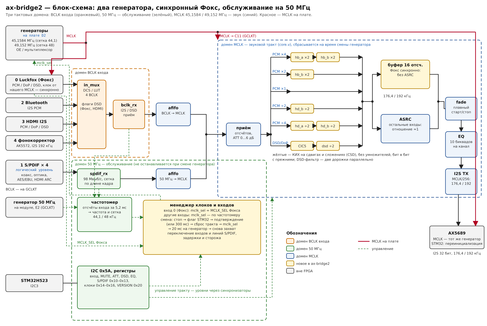

# ax-bridge2 — входной мост AX5689 с двумя генераторами (Tang Primer 25K)

Второй вариант [ax-bridge](https://github.com/DrModd/ax-bridge) для DigiD D2: тот же
коммутатор 5 входов, приёмник S/PDIF, DSD, эквалайзер и I2C (адрес 0x5A), но:

- **два генератора** — 45,1584 МГц (сетка 44,1 кГц) и 49,152 МГц (сетка 48 кГц); выход на
  AX5689 = MCLK/256: **176,4 или 192 кГц**, «родная» сетка источника;
- **Фокс синхронно**: он тактируется тем же MCLK (внешний клок PureFox/DigiFox2), поэтому
  его поток идёт **без ASRC** — фильтры (×4/×2/÷2/÷4, DSD) и небольшой буфер;
- остальные входы — FIFO → фильтры → ASRC с отношением ≈1 (поглощает только разницу
  кварцев); генератор выбирается по частотомеру;
- **обслуживание на 50 МГц** (генератор модуля): I2C, приёмник S/PDIF, частотомер,
  менеджер клоков, переключение входов, таймеры — не останавливается при смене MCLK;
- **КИХ-фильтры без умножителей** (сдвиги и сложения, CSD) — бит в бит как в ax-bridge;
- все клоки — на выводах GCLKT.



Договор со STM32 — `INTERFACES.md` в [DigiD-D2](https://github.com/DrModd/DigiD-D2),
разделы 1 и 1a. Подробности общих блоков (фильтры, DSD, эквалайзер, S/PDIF, регистры
0x00–0x13) — в [README_ax-bridge.md](README_ax-bridge.md).

## Клоки и выбор генератора

| Сигнал | Вывод | |
|---|---|---|
| `sys_clk` | E2 (GCLKT) | 50 МГц, генератор модуля Tang Primer 25K (как в примерах Sipeed, `IO_LOC "clk" E2`) |
| `mclk_in` | C11, J1-51 (GCLKT_13) | MCLK с мультиплексора генераторов |
| `mclk_sel` | K9, J1-5 | выход: 1 — 45,1584 МГц, 0 — 49,152 МГц |
| `fox_fsel` | L9, J1-3 | вход: MCLK_SEL Фокса (GPIO1_D1), 1 — сетка 44,1 |

Авто-режим (CLK_CTRL[0] = 1): на входе 0 `mclk_sel` повторяет MCLK_SEL Фокса; на других
входах — сетку, которую нашёл частотомер (отсчёты входа за 5,2 мс по 50 МГц). Смена:
тракт гаснет → запрос CLK_STAT[1] → подтверждение STM32 (или 300 мс) → сброс тракта →
`mclk_sel` → 20 мс на генератор → новый захват. STM32 после смены перезапускает AX5689
с набором регистров под новый MCLK.

| Рег. | | |
|---|---|---|
| 0x06 VERSION | R | 0x20 |
| 0x14 CLK_CTRL | RW | [0] авто, [1] ручная сетка (1 — 44,1), [2] синхронный путь Фокса, [3] ждать подтверждения; сброс 0x0D |
| 0x15 CLK_STAT | R/W | [0] MCLK 45,1584, [1] запрос ждёт подтверждения, [2] переключение, [3] синхронный путь, [4] частотомер готов, [5] частотомер: 44,1, [7] генератор сменился. W: бит 0 — подтвердить, бит 7 — сбросить [7] |
| 0x16 METER | R | частотомер: [2:0] k, [3] сетка 48, [4] DSD, [7] готов |
| 0x04 PLL | R | 4 — синхронный путь (без ASRC) |

После смены генератора тракт сброшен: эквалайзер выключен, STM32 загружает коэффициенты
заново — **для текущей частоты выхода** (176,4 или 192 кГц).

## Выводы входов (изменения против ax-bridge)

Все BCLK — на выводах GCLKT: Bluetooth `in2_bclk` → **J8** (J1-7), HDMI `in3_bclk` → **F7**
(J1-11), DATA фонокорректора `in4_sdata` → **L10** (J1-42). Освободились E10, F5, H11
(H11 — GCLKT_16, запасной клоковый вход). Полный список — `gowin/ax_bridge.cst`.

**На Dock** выводы H11 и H10 заняты кнопками S1 и S2. H11 теперь свободен, а на H10 сидит
линия ARC (`spdif_in[3]`): при проверке на Dock S2 не нажимать, ARC проверять последним.
На своей плате (только модуль) это обычные выводы.

## Фильтры без умножителей (`rtl/fir_csd.v`)

Коэффициенты hb_a, hb_b, hd_a, hd_b и DSD-фильтра записаны в канонических знаковых
разрядах (CSD); на каждый выходной отсчёт маленький автомат выполняет программу
`coef/*.prog` (`tools/gen_coefs.py`): LOAD отвода, ADD симметричного отвода, TERM ±x<<s,
END. Оба канала одновременно, нулевые отводы полуполосных фильтров пропущены,
DSD-фильтр — две дорожки параллельно. Результат бит в бит равен умножителям
(`make csd`: все пять фильтров на своей наибольшей входной частоте). Умножители
остались у ASRC (переменная фаза), эквалайзера (коэффициенты по I2C), ATT и fade.

## Проверка

```
make csd     # CSD-фильтры == умножители, бит в бит
make v2      # Фокс 44,1/96/DSD64 синхронно, S/PDIF 44,1 и фоно 192 по частотомеру, смена генератора
make verify  # всё (прежние стенды работают с фиксированным 49,152 МГц, CLK_CTRL = 0)
```

Результаты `make v2` (THD+N на выходе): Фокс 44,1 кГц синхронно −143 дБ, Фокс 96 кГц
−144…−148 дБ, S/PDIF 44,1 кГц через ASRC −138 дБ, фонокорректор 192 кГц −139 дБ,
Фокс DSD64 −102…−105 дБ (предел самого DSD-сигнала).

## Сборка в Gowin IDE

Как ax-bridge: устройство GW5A-LV25MG121NC1/I0 (версия B), Verilog 2001, все `rtl/*.v`
кроме `fir_stage.v` (он только для сверки в тестах), `gowin/ax_bridge.cst`, `.sdc`;
в `top.v` полный путь в `COEF_DIR`. SSPI как обычные выводы — включить.
